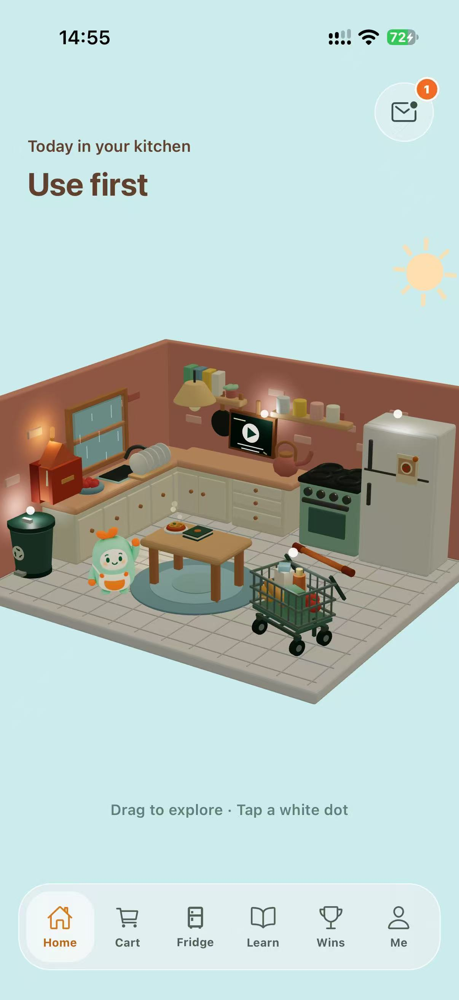

# KitchMemo Product Document

KitchMemo is a mobile household food-management and food-waste learning product developed by Team Gress for Monash FIT5120. It helps young adults see what food they have, plan purchases, record how food is used and learn practical waste-reduction habits. This document explains its value, delivered scope and what a future sponsor would need to sustain it.

Version 1.0 | 12 October 2026 | Audience: potential sponsors and business owners

## 1 Product purpose and audience

The primary audience is adults aged 18 to 35 managing food alone or with a partner. Forgotten ingredients, uncertain quantities and disconnected shopping lists can lead to repeat purchases and avoidable waste. KitchMemo connects inventory, shopping and household sharing through a miniature interactive 3D kitchen, supported by reminders, optional AI and educational activities.

The intended benefit is better visibility and more informed decisions. Waste reduction, financial savings and learning impact have not been established by a controlled field study. Displayed household metrics are derived from user-recorded activity, not independent measurement of food disposal or carbon emissions.

## 2 Delivered product

| Capability | Value to the user |
| --- | --- |
| Interactive kitchen and bilingual interface | A visual entry to household tasks; the application supports English and Chinese |
| Inventory and flexible entry | Record individual batches manually, by barcode or through optional limited produce-photo recognition; review suggestions before saving |
| Dates and reminders | Distinguish package dates and estimated quality; organise food needing attention |
| Shopping and shared fridge | Compare stock, maintain a shared list, review purchases and coordinate through invitations |
| Spoonie assistant | Optional guidance using authorised fridge context; supported changes require explicit confirmation |
| Achievements and reports | Household progress, quests and recorded use/discard metrics with price-coverage limitations |
| Learn and packaging activities | Personal courses, server-graded checkpoints and contextual sorting guidance; local collection rules still apply |
| Privacy and recovery | AI permission management, one-time identity recovery and explicit deletion of the current identity's associated data |

Figure 1. Genuine English iPhone application capture supplied for the 1.0.0 submission. The Support Document contains the other main screens and task instructions.

## 3 Release scope and limitations

The latest recorded iOS release is 1.0.0 build 13, submitted to Apple and waiting for review on 12 October 2026. It supports iPhone with iOS 16.4 or later; iPad, Mac and Vision Pro distribution are excluded from this first release. Android is supplied as a preview APK, not a Google Play production release. Business use through a web browser is currently unsupported despite a web development script.

A new installation creates an anonymous device identity; there is no email/password login. Internet access is needed for authoritative data operations. Photo recognition covers eight produce types and is not a food-safety test. Intelligent recipe discovery is paused. The latest learning release waived physical-device acceptance by owner decision; independent tutor content review remains pending under a recorded version-specific owner publication exception.

## 4 Resources and sponsor opportunity

A suitable sponsor could be a university sustainability programme, a food-waste education organisation or a community household pilot. These are proposed fits, not confirmed partnerships. A sponsor could pilot the product with young households and evaluate adoption, inventory upkeep, learning completion and support demand before deciding on expansion.

Sustained operation needs a product owner, an Expo/React Native and Node maintainer, a person responsible for database/security operations, a support contact and a reviewer for food and local disposal content. Roles may be combined in a small pilot. Services include Supabase, Vercel, EAS/Apple distribution, optional AI providers and the separate photo-model endpoint. Account ownership, subscription tiers and ongoing costs need sponsor confirmation; no budget commitment is implied.

Future opportunities include independent content review, broader device acceptance, accessible interface verification, evidence-based pilot evaluation, improved receipt monitoring and regional content expansion. Extensions such as voice interaction, recipe discovery or account-based identity require separate scope, privacy and feasibility decisions.

## 5 Ethics and professional responsibility

The accompanying Ethics Canvas examines affected users, data processing, food guidance, shared ownership and environmental claims. Safeguards include editable AI suggestions, explicit AI consent, server-side authorisation, restricted answer disclosure during assessments and confirmed assistant actions. The product must present estimates and learning results accurately and retain manual alternatives.

The ACS mapping addresses public interest, quality of life, honesty, competence, professional development and professionalism. The official ACS website also presents the newer ethics values of honesty, trustworthiness and respect. This is a project evidence mapping, not a certification of compliance. Confirm the edition prescribed in Moodle and reconcile the accompanying canvas with its template. [ACS professional ethics and conduct](https://www.acs.org.au/memberships/professional-ethics-conduct-and-complaints.html)

The repository contains an MIT licence file with an Expo copyright notice. Team code ownership, generated-media rights and third-party attribution must be reviewed before commercial transfer; the existing file alone is not proof that every asset is cleared.

## 6 Team and product access

Team Gress comprises Guanxin Wu (MIT), Jingduo Zhang (MIT), Haoxuan Sun (MBIS), Yang Qiao (MDS) and Chang Lei (MCS), as recorded in the local project introduction. The public operational contact is Haoxuan Sun at nariyirm@gmail.com. Individual responsibilities, other member emails and team LinkedIn links are not established by those records; see the information register. Industry mentor: Hilda Permata, [LinkedIn](https://www.linkedin.com/in/hilda-permata-9387a2a2).

- Source: https://github.com/Gress-FIT5120-26S2/Gress
- Product API and public support: https://kitchmemo-api.vercel.app/support
- Android installer and iOS build/TestFlight access: Release and Delivery Register
- Product film: `08_Product_Video/KitchMemo_90s_Final_v12.mp4`
- Ethics Canvas and ACS mapping: `06_Appendices/Ethics_Canvas_and_ACS_Mapping.docx`
- Full PG portfolio and individual LinkedIn links: awaiting registered URLs

No application login password is required. iOS testing requires authorised TestFlight access. Platform administration credentials are transferred privately through the ownership process, never embedded in this document.

## 7 Sponsor next steps

Review the product and film, nominate the receiving owner, confirm installation and platform access, then complete user and technical knowledge transfer. Conduct UAT against the registered build and explicitly accept or resolve remaining issues. The Support and Maintenance Documents explain everyday operation and continued development; separate sponsor and Monash forms record receipt and acceptance.
