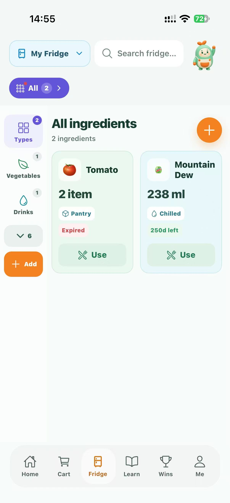
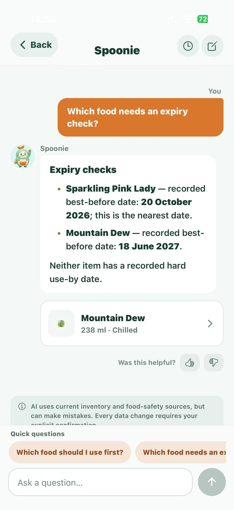
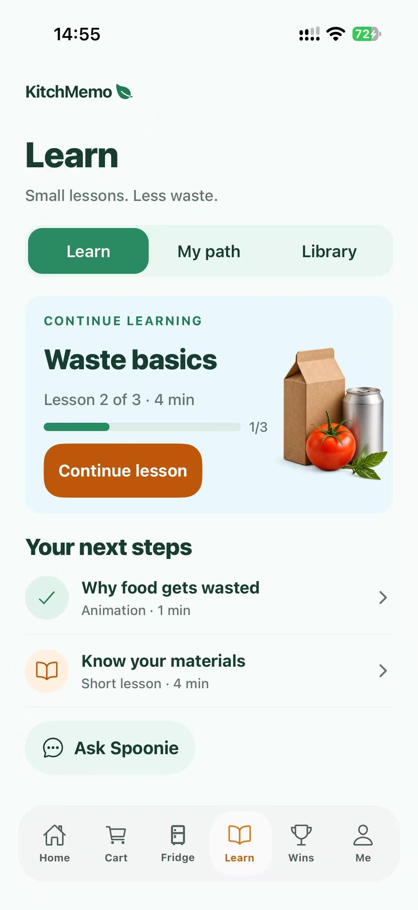
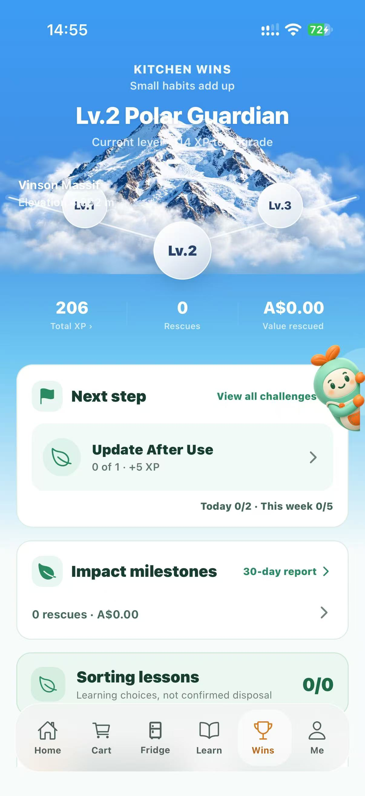

# KitchMemo Support Document

This guide enables a sponsor's support staff and household users to install and operate KitchMemo 1.0.0, explain its main features and resolve common problems. Follow the task instructions on a disposable test installation before using real household records. Technical infrastructure operations are covered in the Maintenance Document.

Version 1.0 | 12 October 2026 | Prepared by Team Gress

## 1 Access and first use

Use the installation links in the Release and Delivery Register. The current iOS acceptance target is build 13 through authorised TestFlight access while Apple review is pending. A production-signed IPA does not provide unrestricted sideload access. Android is a preview APK; download it from the registered EAS artifact and follow the device's installation permission prompts. Preserve the existing signing identity for upgrade testing. Uninstalling to resolve a problem may lose the current anonymous identity.

The first iOS release supports iPhone, not iPad. Android's SDK baseline is Android 7 or later, but suitability and 3D performance on an individual device require testing. The app is intended for portrait use. There is no supported browser-based business client and no email/password login.

1. Open KitchMemo with an internet connection and let the opening sequence complete.
2. Follow the first-use journey. A new installation receives a device identity and an empty personal fridge.
3. Open Profile and set a recognisable nickname. A nickname identifies a household member visually but does not grant access by itself.
4. In the language settings, choose English if required. This package uses English screenshots; the installed app also offers Chinese.
5. Create and securely retain a recovery code before changing devices. See section 10.
6. Grant camera, photo-library or notification permissions only when you use the related feature. AI processing requires its own explicit permission.

## 2 Navigation and the kitchen

The kitchen is the home screen. The fridge, shopping cart and mailbox provide contextual entry to stock, shopping and notifications. The English build labels its main tabs Home, Cart, Fridge, Learn, Wins and Me. This guide uses Shopping for the Cart workflow, achievements for Wins and Profile for Me. Use the visible tabs if a 3D hotspot is difficult to select.

The kitchen's freshness and unread indicators use the same inventory and notification state as the detailed screens. Near-expiry counts represent batches needing attention, not a direct total of kilograms or individual physical pieces. Background refresh can update these indicators without replacing the whole screen with a loading view.

The home blackboard opens the food-waste story; the waste-bin entry opens learning. Ordinary tab switches retain the session's screen state. If data appears stale, bring the app to the foreground or refresh the relevant list. The app has no guaranteed offline write queue: do not treat an unsent form as a saved record.

## 3 Record and manage food

### 3.1 Add food manually

1. Open Fridge, use the add-item control and select manual entry.
2. Enter the food name. Select a suggested food if appropriate; otherwise fill the details yourself. Optional AI generation can supply an editable suggestion after consent.
3. Set quantity and unit. Supported units include item, g, kg, ml, L, bag, bottle and box. Initial quantity must be positive. The strict upper bound is 1,000,000 for g/ml and 1,000 for the other units; those boundary values themselves are not accepted.
4. Select the category and storage location: chilled, frozen or pantry.
5. Enter the purchase price. Use zero for a genuinely free item, not for an unknown price. Existing legacy records can have unknown prices and are excluded from monetary calculations as appropriate.
6. If using a package date, select its correct type and enter the date. Dates may be omitted. Review purchase/opening dates and the advance reminder window if present.
7. Review the packaging/waste components. An empty component list means no waste material; uncertain materials should remain uncertain until checked.
8. Save once and confirm the item appears in the fridge. If a request fails, refresh before creating a duplicate batch.

Every addition creates a separate batch. Two cartons of the same product purchased on different occasions can have different quantities and dates. Never assume an aggregated food card represents a single interchangeable batch.

Figure 2. Inventory capture showing batch quantities and dates. Use the intended batch when editing or recording use.

### 3.2 Scan a barcode

1. Choose barcode entry and grant camera permission if needed.
2. Scan the product's EAN/UPC code or follow the supported entry controls.
3. Review the product name, brand, packaging and suggested category returned through Open Food Facts.
4. Enter the physical item's purchase price and package date yourself. A database result is not evidence of the date printed on your package.
5. Correct any fields and save using the normal entry form.

An invalid code, missing product or upstream failure can be handled by manual entry. Do not repeatedly scan an unsupported code to bypass an error or rate limit.

### 3.3 Use a food photo

Photo recognition supports banana, bitter melon, cucumber, eggplant, orange, papaya, pineapple and tomato. Other foods or packaging may not be recognised reliably.

1. Select photo recognition and review the external-AI permission prompt.
2. Use the camera or photo library to provide one clear food image.
3. Review the recognised name and suggested condition. The model can label fresh, semi-fresh or rotten; these are fallible suggestions.
4. Inspect and correct the editable form, including quantity, storage, price and actual package dates.
5. Save only after checking the details. Use manual entry for an unknown result or failed request.

The server accepts JPEG, PNG or WebP up to 10 MB and forwards the image in memory to a separate food-recognition service. The application does not save that image to its own database or server disk. This does not promise that a third-party processor retains no data. Never use photo recognition as proof that food is safe.

### 3.4 Find and edit a batch

Search by name and apply storage, category or attention filters. Open the intended item to view details. Edit the fields offered, check the date type and price, then save. Pull down on the list to refresh when checking another household member's update.

Shared edits use a batch version. If a conflict appears, reread the updated batch and decide whether the change is still appropriate. A failed version check must not be followed by blindly repeating a quantity deduction.

### 3.5 Record use or remove an item

Use the quick-use control to enter the amount consumed; the resulting remaining quantity must be between zero and the batch's initial quantity. A positive use amount cannot exceed what remains. Decimal quantity input supports up to three places. Confirm the deduction and check the updated list.

When removing food, select the true outcome offered by the interface: used, discarded with a reason, or a data correction where supported. A correction is not consumption and must not be described as waste avoided. Past a recorded use-by date the server rejects consumption. It does not independently observe whether food has actually been discarded.

Changes can trigger a packaging-learning opportunity. The inventory mutation succeeds independently of whether the user answers that educational question.

### 3.6 Categories and replenishment

Use existing categories wherever possible. Custom categories belong to the current fridge and are shared with its members; the current backend allows at most 12 custom categories. Generated icons require external-AI permission and provider availability. Missing images have fallbacks.

Set a replenishment threshold and target where the item controls offer it. Restock recommendations aggregate matching food and units. Different units are not automatically convertible or additive. A threshold is a shopping aid, not an automatic purchase.

## 4 Interpret dates and reminders

Use-by dates are safety limits from the package or a confirmed reliable source. Best-before dates concern quality. System-generated quality estimates are planning aids, not a safety deadline or guarantee. The legacy display date can have an uncertain source and is not automatically a use-by limit. Follow the package's storage and handling instructions; do not allow AI advice or reward incentives to override a use-by limit. [FSANZ date marking guidance](https://www.foodstandards.gov.au/consumer/labelling/dates)

The fridge's near-expiry filter and home indicator use a three-day attention window. A batch's configurable local reminder can use an advance window of one to seven days. These two concepts need not fire at the same moment.

1. Open Profile, then Notifications and Reminders.
2. Set the overall reminder and home badge options.
3. Set categories such as expiry, replenishment, shared activity and system reminders.
4. Enable system delivery if desired, then grant device-level notification permission.
5. Configure quiet hours and verify the time zone.
6. Use the notification-history entry or kitchen mailbox to review messages. Marking a message read changes only your installation's read state.

Local reminders cover up to the earliest 32 eligible expiry batches, with a local recall reminder after seven days of inactivity. This is not a guarantee that every batch gets a separate native notification. Shared inventory activity can generate remote push to eligible other members. System settings, quiet hours, revoked tokens and provider delivery can suppress a push even when the in-app message exists. Expo Go is not the remote-push acceptance environment; use a real installed build.

## 5 Shop and bring purchases into inventory

1. Open Shopping and review replenishment suggestions against current stock.
2. Add useful suggestions to the cart or add a manual shopping item.
3. Edit names, quantities and units when needed; household members share the same fridge's cart.
4. Mark purchases as bought and open checkout review.
5. Review duplicate-stock warnings and add purchases to inventory through the entry flow or the available one-tap option.
6. Confirm price, dates and uncertain packaging. If enrichment requires confirmation, finish the entry form.
7. Check each successful stock result before closing. The app warns when leaving purchases not yet stocked.

Marking a shopping item bought is not by itself proof that its inventory batch was created. For a lost response, refresh both inventory and checkout status before trying again. Manual pending items have device ownership for leaving a household; derived restock items can belong to the shared fridge.

## 6 Share a household fridge

### 6.1 Create or join

The fridge screen's sharing entry is the primary location for sharing management. A device belongs to one fridge at a time.

1. From a personal fridge, open sharing, name the household and create an invitation. This converts the current fridge to shared mode; it does not create a second active personal fridge.
2. Share the invitation code or QR only with intended household members. Treat it as access information.
3. On a second installation with a personal fridge, open the join option and enter or scan the invitation.
4. Read the merge explanation before confirming. Existing personal stock moves into the target household, while same-name batches remain separate.
5. Verify the member list and shared inventory on both installations.

An invitation can be used, revoked, expired or not found. Request a fresh invitation for the actual state rather than assuming all failures mean a typo. Rotating the invitation invalidates the old active code.

### 6.2 Manage or leave

Use the shared-fridge management view to review members, change the fridge name or rotate an invitation. Member display names are not their credentials. Shared mode remains active even if only one member is present.

Leaving creates a personal fridge and transfers the departing device's eligible active inventory and unbought manual cart items. Household achievements, other members' stock, completed cart entries and historical inactive batches remain with the household. Read the confirmation and inspect the resulting personal fridge.

Learning progression and chat history are private: joining a household does not make another member's learning level or conversations visible. Leaving and deleting an identity are different operations; review deletion's broader consequences in section 11.

## 7 Ask Spoonie for fridge help

Open the fridge assistant entry or the Spoonie entry presented in the build. Ask about authorised stock, dates, consumption history, replenishment or shopping. General unrelated requests can be declined because the assistant has a bounded product scope.

Figure 3. Actual assistant conversation capture. Generated text is guidance and must be checked against the recorded facts and package label.

For supported write actions, Spoonie presents a proposal. Review the affected item and the change, then explicitly confirm or cancel. Reading a suggestion alone does not authorise an inventory mutation. Pending actions last ten minutes and can expire or conflict if the batch changes. An expired proposal needs a fresh request; repeated confirmation must not produce repeated changes.

Use the conversation-history feature to revisit your available private chats; starting a new conversation does not delete earlier history. The current conversation retention window is 30 days. Feedback concerns response quality, not a guarantee that a support employee has received a ticket. Provider errors and rate limits should leave manual stock and shopping controls available.

## 8 Learn and packaging sorting

### 8.1 Courses and assessments

Open Learn to browse courses, activities and resources. Read or watch an activity and use its completion controls. Learning is personal to the device's learner identity, unlike shared household achievements.

Figure 4. Published learning hub capture. Course content and eligibility are read from the server.

Formal checkpoints use 6, 8 or 10 questions depending on stage; the 80 percent threshold means at least 5, 7 or 8 correct answers respectively. The server freezes the first answer. Restarting a request or changing a local screen does not replace that answer. Use the offered next, finish, resume or review actions. Practice and mixed review do not unlock formal stages or award household inventory XP.

If the app closes, reopen it and resume from the server's saved cursor. A withdrawn content version may invalidate an unfinished attempt while preserving previously earned eligibility. Do not reset the installation simply to retry a network error.

### 8.2 Learning tutor

Spoonie's learning tutor is separate from the fridge assistant. It uses authorised public learning evidence and the learner's permitted feedback. During an active formal checkpoint, free chat and extra practice are restricted; available explanation controls concern already answered questions. It cannot mark a formal answer correct or alter a score.

Where offered, review tutor recommendations, manage proactive/personalised help and delete tutor history. Declining proactive help does not mean the user has consented to an AI request. External-AI permission is still required. Published tutor v3 has owner review, with independent review pending; report questionable educational content to support.

### 8.3 Packaging questions and story

After eligible recorded use, confirm the actual packaging material when asked and answer the sorting activity. Multiple packaging components can produce separate opportunities. Unknown materials can provide guidance without a universally correct bin. Follow your council's actual collection rules, especially for food organics, glass, soft plastics and mixed packaging.

Correct answers count as learning, not proof that a physical item was recycled or a carbon saving occurred. These answers do not award household XP or savings. The home food-waste story provides an educational explanation; it is not a local waste-service directory.

## 9 Achievements and reports

Open the achievements or progress destination to see the household mountain level, medals and daily/weekly quests. Progress is calculated by the server from eligible records and unique event sources. Previewing a level does not change the true level.

Figure 5. Genuine progress capture. The original capture contains some overlapping text near the mountain; this known visual issue is retained rather than retouched.

The current rules allow up to three replacements per daily or weekly period, subject to eligibility and available alternatives. Replacement progress starts from the new assignment's effective start; earlier events are not retrospectively counted toward it.

Open the stage report to review the last 30 days, weekly activity groupings, discard reasons/categories and upcoming dated stock. Financial summaries use recorded eligible prices and coverage indicators; unknown legacy prices are not fabricated. Mixed currencies and units must not be interpreted as a measured household total. Reported use, rescued value and disposal are distinct concepts.

## 10 Protect and recover the device identity

1. Open Profile settings and the device-recovery entry.
2. Generate a recovery code and save it privately, for example in a password manager. Do not include it in screenshots, shared invitations or support tickets.
3. On the replacement device, enter the code in the restore controls and review the merge/transfer confirmation.
4. After success, retain the newly generated code. The prior code and former device credential are revoked.
5. Recheck nickname, stock, household membership and personal learning. Reauthorise AI and device notification permissions as needed; AI consent does not automatically transfer.

Recovery transfers identity ownership and can merge the new device's temporary personal state under the implemented recovery rules. It does not create email-based access. If the original identity and valid recovery code are both lost, support cannot promise restoration from a nickname or a known device ID. Escalate privately and do not attempt to bypass authentication.

## 11 Privacy and deletion

Open Profile, then Privacy, to read the policy, manage external-AI permission, visit support or delete your data. AI permission is off by default. The prompt identifies OpenAI, Google Gemini, Cloudflare Workers AI and the separate photo service. Declining leaves manual inventory, shopping and static course use available; withdrawing stops future covered requests but cannot recall a request already processing with a provider.

To delete, read the consequences and use the explicit destructive confirmation. This removes the identity and associated private records, credentials and recovery codes; it also removes stock/cart records within the implemented creator/owner scope. Other household members' original records remain. References to deleted custom categories move to Other. The old identity cannot bootstrap again.

Wait for the deleted-state screen. Choose Start again only if you want a new empty identity. Old recovery codes do not restore the deleted identity. Storage-asset removal may be retried asynchronously. Backup and third-party retention are not promised to disappear instantly. Historical recovery chains predating the latest migration may require verified support investigation.

Public policy: https://kitchmemo-api.vercel.app/privacy. Support: https://kitchmemo-api.vercel.app/support. Public contact: nariyirm@gmail.com.

## 12 Routine support and service continuity

Suggested pilot routine: review support messages and service availability each working day; investigate failed uploads, provider errors and recurring sync problems; review backups and cost usage weekly; review dependency/content maintenance monthly. These are proposed routines, not an agreed SLA.

Support staff should use the application and approved support channels. There is no dedicated browser administrator console in this release. Bulk loading, direct data edits, restores and reference-data updates are technical maintenance tasks, not steps to perform in a user's session.

A user's recovery code restores identity access; it is not a database backup. A database backup protects service data; it does not include Supabase Storage object files automatically. The technical owner must separately arrange Storage protection and a tested restore plan. Backup status and restore objectives are currently awaiting owner confirmation. [Supabase backups](https://supabase.com/docs/guides/platform/backups)

## 13 Troubleshooting

| Symptom | First action | Escalation or explanation |
| --- | --- | --- |
| Opening or list stays unavailable | Check connection, return to foreground, retry or refresh once | Supply build, device/OS, time and screen; API health alone does not prove all routes work |
| Missing stock after reinstall | Check whether this is a new installation identity | Use a valid recovery code; do not overwrite or invent ownership |
| Shared list differs between phones | Confirm the same household, refresh and reopen foreground | Broadcast can fall back to periodic probes; escalate persistent mismatch |
| Edit conflict | Read the latest item and reconsider the change | Do not repeat a deduction automatically |
| Invitation refused | Check its reported state and obtain a fresh code | Used/revoked/expired codes require owner action |
| Camera or photos unavailable | Check OS permissions | Manual entry remains available |
| Photo identifies the wrong food | Correct or discard the prefill | Limited eight-class recognition; not a safety test |
| AI permission denied | Review Profile Privacy and opt in only if desired | Manual tasks remain usable |
| AI temporarily unavailable | Wait, inspect response and use manual controls | Respect rate-limit retry time; repeated calls can incur costs |
| No system notification | Check OS permission, app switches, quiet hours and time zone | Check in-app history; remote-push acceptance requires an installed build |
| Checkpoint cannot advance | Check saved first answers, stage requirements and current attempt | Server grades are authoritative; tutor cannot unlock stages |
| Achievement value looks incomplete | Inspect price coverage and recorded outcomes | Unknown prices and corrections are not savings |
| Deletion request outcome unclear | Reopen to recover the deleted-state result | Do not attempt bootstrap or reuse the erased identity |

## 14 Support escalation and training

A support report should contain the exact build/platform, OS/model, local date and time with time zone, affected feature, steps, expected/actual behaviour and a redacted screenshot if useful. Do not request credentials, recovery codes, invitation codes, complete chat histories or images containing unnecessary personal details. Send incident reports to the registered public support contact unless the receiving organisation has established a replacement channel.

For a suspected security incident, stop reproducing it on real user data and notify the technical owner privately. For data errors, establish the scope before requesting a correction. Food-safety concerns must not be decided by support on the basis of a photo-model label.

Complete the support exercises in the Knowledge Transfer Plan, including a two-device sharing task, a notification diagnosis and identity recovery in a test setting. Record the receiving staff's completion rather than assuming reading the document establishes competence.

## 15 References

Local basis: `PRODUCT.md`; `App.tsx`; `src/components/`; `src/services/`; `src/i18n.tsx`; `server/src/routes/`; `docs/data-architecture/BACKEND_DATA_CONTEXT.md`; `docs/app-store/RELEASE_STATUS.md`; `docs/app-store/REVIEW_NOTES.md`; `docs/app-store/SCREENSHOTS.md`. Older dated specifications can contain superseded states; the release register and deployed migrations control the recorded baseline.

Standards are reference points rather than certificates: date wording follows FSANZ; accessibility objectives use WCAG AA as a design target, with no complete conformance audit recorded. The Ethics Canvas lists the ACS mapping and outstanding review work. See the Source and Evidence Register for precise sources and external references.
