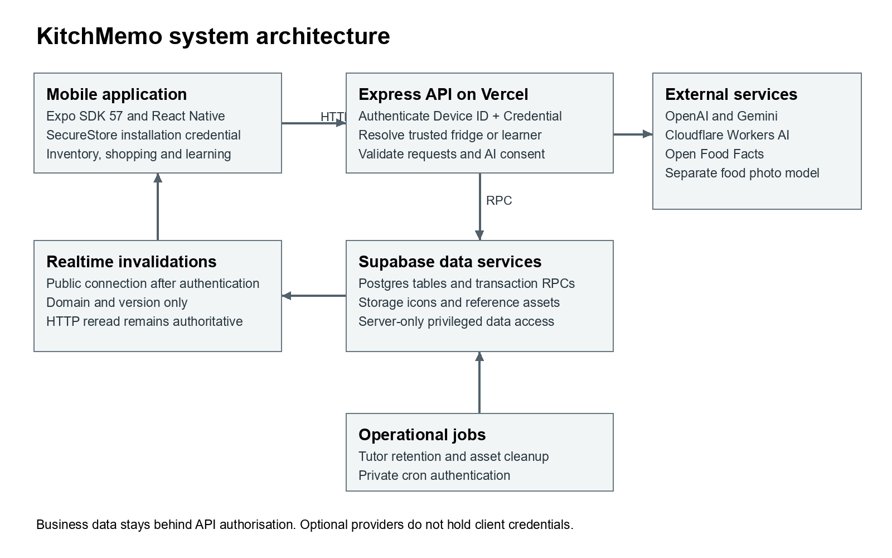
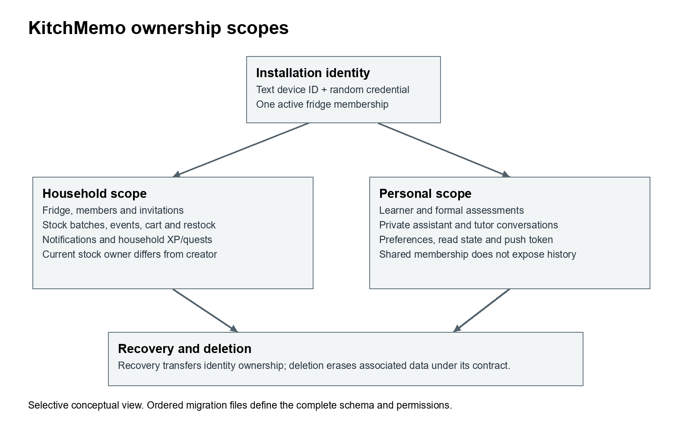

# KitchMemo Maintenance Document

This manual enables a receiving developer to run, maintain and extend the registered KitchMemo release. It documents the inspected source baseline, its data boundaries, deployment sequence and operational recovery practices. Complete the practical receiving checks before taking responsibility for production.

Version 1.0 | 12 October 2026 | Team Gress | Source baseline: a37304cd7746f61872673cc9d8d05e8f7536badf

## 1 Baseline and authority

The source repository is https://github.com/Gress-FIT5120-26S2/Gress. The Release and Delivery Register identifies current builds and environments. The latest dated record reports 58 migrations in development and production through `20261012100000_app_store_privacy_and_erasure.sql`, 54 public tables with RLS enabled and no ordinary anon/authenticated table grants. These are recorded audit results, not an independently repeated remote audit during package preparation.

Authority order: deployed ordered migration files for schema/behaviour; current route and service code for HTTP behaviour; the newest dated release verification for deployment status; then explanatory documents. The backend context deliberately retains historical sections. Its older statements such as no recovery support, fewer tables, pending production migrations and permanently draft learning content are superseded by newer code and release records.

Read `AGENTS.md` and the complete `docs/data-architecture/BACKEND_DATA_CONTEXT.md` before changing schema, data routes, bootstrap, sharing, inventory, notifications or achievements. Follow the repository's concise bilingual comment convention when code intent is non-obvious. This package does not change application code or database behaviour.

## 2 Architecture and trust boundaries



Figure 1. The API owns business authorisation. Realtime carries invalidation signals; it does not provide a second business-data read path.

| Layer | Current source declaration or record | Responsibility |
| --- | --- | --- |
| Mobile | Expo ~57.0.23, React Native 0.86.3, React 19.2.3, TypeScript ~6.0.3 | Presentation, device credential storage, task input and local reminders |
| Scene | Three.js, React Three Fiber, Drei, Expo GL | 3D kitchen, characters and scene interactions |
| API | Node, Express ^5.2.1 | Device authentication, fridge/learner scoping, input checks and provider orchestration |
| Data | Supabase Postgres, Storage, Realtime | Transactional records, reference assets and domain-version invalidations |
| Deployment | Vercel API, EAS mobile builds | Separate API deployment and native release lifecycles |
| Optional providers | OpenAI, Gemini, Cloudflare, Open Food Facts, photo model | Bounded AI, enrichment, icons, barcode data and limited image recognition |

`App.tsx` coordinates screens and retained providers. Client business requests go through `src/services/apiClient.ts` to Express. SecureStore holds installation ID and a random credential. Express authenticates both headers, resolves the unique fridge and calls service-role queries or transaction RPCs. A service-role key bypasses RLS, so a new route must enforce its own trusted scope before querying.

The only permitted direct Supabase connection on the client is `@supabase/realtime-js` Broadcast with public connection information supplied by an authenticated sync session. The capability topic is high-entropy and held in memory. Payloads contain domain/version/timestamp, not stock, messages, names or credentials. On invalidation, the app rereads authorised HTTP endpoints. Normal reconciliation is every 30 seconds; shared disconnected mode uses a six-second probe, with foreground reconciliation and error backoff.

## 3 Developer setup

### 3.1 Prerequisites

Use Node 22.13.x or later as required by the exact Expo SDK 57 reference; the recorded Vercel release used Node 24. The older repository README's Node 20 advice is insufficient for the SDK 57 client. Match a supported Node 24 runtime for the team baseline where practical. Install npm, Git and the platform tooling you need. Local iOS Simulator/native iOS building requires macOS/Xcode; Windows can use Android and hosted EAS builds. Docker is needed for a full local Supabase stack, not for a hosted development project.

Exact versioned reference: https://docs.expo.dev/versions/v57.0.0/. SDK 57 targets React Native 0.86 and iOS 16.4 or later. Do not upgrade Expo, React and React Native independently from their compatibility set.

### 3.2 Get source and install locked dependencies

Clone the repository into a new checkout or use the accepted source archive. Select the registered baseline before making a feature branch. Preserve any pre-existing uncommitted work. From the repository root run:

```powershell
node --version
npm --version
git status --short
npm ci
npm ci --prefix server
```

Both lockfiles are part of the reproducible setup. If an installation fails because a registry/package is unavailable, retain the error and resolve the dependency explicitly instead of silently rewriting the lockfile.

### 3.3 Configure development only

```powershell
Copy-Item .env.example .env.development
Copy-Item server/.env.example server/.env.development
```

Client example:

```env
EXPO_PUBLIC_API_URL=http://10.0.2.2:3001
```

Android Emulator uses 10.0.2.2; iOS Simulator uses localhost. A physical phone uses the development computer's reachable LAN IP and an allowed firewall port. Metro access and API access are separate connections. The client must never receive service-role, AI, cron or administrative credentials.

Edit only your local server file with the development project's Supabase URL, secret key and public Realtime key. Optional services can be configured separately. All real environment files remain outside version control. `server/src/env.js` loads the file from the server process working directory: by default `.env.development`, or `.env.production` when NODE_ENV is production, with a legacy `.env` fallback. Platform-provided variables take priority. Starting through `npm --prefix server` establishes the intended working directory.

### 3.4 Initialise the development database

For the existing team environment, request authorised access and confirm the project is `Gress-development` (`thmbtsssvnslotoexntz`). For a new project, apply the complete ordered migration history and inspect any environment-bound configuration before proceeding. Content publication exceptions and existing references are historical records, not a licence to bypass future review.

```powershell
npx supabase link --project-ref thmbtsssvnslotoexntz
npx supabase migration list
npx supabase db push --dry-run
```

After verifying the target and expected files, apply pending migrations with `npx supabase db push`, then run `npx supabase db lint --linked --level warning`. Do not apply seed casually to production. Seed is optional reproducible reference data only, not a household-data import or substitute for migrations.

### 3.5 Start the API and app

For the existing named team development database, `npm start` runs Expo plus `dev:learning`. That launcher asserts the exact development hostname and non-production mode, then enables draft development gates and tutor flags without rewriting env files. It will intentionally fail for an arbitrary new Supabase project.

For a new database or published-only operation, use separate terminals:

```powershell
npm run server:start
```

```powershell
npm run start:expo
```

Set the tutor feature flags explicitly if testing tutor capability. Do not remove the named-project checks to make draft gates run against production. Use `npm run start:clear` only when restarting the named development flow with Metro cache reset. Android uses `npm run android`; iOS Simulator uses `npm run ios` on macOS. `npm run web` exists, but installed device identity rejects Web, so it is not a supported business acceptance path.

### 3.6 Confirm a successful setup

```powershell
Invoke-RestMethod http://localhost:3001/api/health
```

Expected body: `{"status":"ok","database":"connected"}`. Then launch the app, initialise a disposable device, create a manual stock item, read it back, record partial use and refresh. Check that the phone points to development rather than the production domain. A health response alone does not exercise authentication, migration dependencies or optional providers.

## 4 Configuration inventory

Use `server/.env.example` as the configuration reference, supplemented by current code and the settings below. It does not currently list every later tutor or cron field; do not assume copying it enables all features.

| Variable or group | Location | Purpose |
| --- | --- | --- |
| EXPO_PUBLIC_API_URL | Client/EAS environment | Sole public business API base URL |
| SUPABASE_URL | Server | Environment-specific project URL |
| SUPABASE_SECRET_KEY | Server secret | Privileged data access; legacy SERVICE_ROLE_KEY fallback exists |
| SUPABASE_PUBLISHABLE_KEY | Server | Public Realtime setup after device authentication; never substitute a secret |
| PORT | Local server | Default 3001; let Vercel manage its runtime |
| CORS_ALLOWED_ORIGINS | Server | Exact browser-origin allowlist; empty denies browser origins |
| OPENAI_API_KEY | Server secret | Assistant and tutor model processing and embeddings |
| OPENAI_ASSISTANT_MODEL | Server | Repository default gpt-5.6-luna; change only after evaluation |
| OPENAI_EMBEDDING_MODEL; OPENAI_EMBEDDING_DIMENSIONS | Server | text-embedding-3-small, 1536; vector schema depends on dimensions |
| GEMINI_API_KEY and GEMINI_PRESET_MODEL | Server | Structured food/packaging enrichment; recorded default gemini-3.5-flash-lite |
| CLOUDFLARE_ACCOUNT_ID; CLOUDFLARE_AI_API_TOKEN; CLOUDFLARE_ICON_MODEL | Server | Reusable icons; recorded model @cf/black-forest-labs/flux-1-schnell |
| FOOD_RECOGNITION_API_URL | Server | Separate CloudFront-backed model endpoint |
| OPEN_FOOD_FACTS_USER_AGENT | Server | Identified barcode client; replace example contact with monitored operational contact |
| EXPO_ACCESS_TOKEN | Server secret if enabled | Optional secured Expo push-service access |
| LEARNING_TUTOR_ENABLED | Server | Master tutor flag; recorded production value 1 |
| LEARNING_TUTOR_COACHING_ENABLED | Server | Permitted coaching; recorded production value 1 |
| LEARNING_TUTOR_PROACTIVE_ENABLED | Server | Proactive capability; recorded production value 1 |
| LEARNING_ROOM_ALLOW_DRAFT; LEARNING_ROOM_DRAFT_PROJECT_REF | Development only | Dual draft gate, accepted only for named development project and non-production |
| CRON_SECRET | Server secret | Authenticates administrative asset cleanup |
| Rate-limit overrides | Server | Perimeter and independent sensitive scopes; retain safe defaults and Retry-After behaviour |

Model names here describe the repository baseline, not a claim about current provider availability or best model choice. Check provider availability, limits and prices before a new deployment. Secrets must be transferred through an organisation-approved password/secret manager; record permissions and rotation responsibility in the ownership register, never their values.

## 5 Data model and scope



Figure 2. A selective ownership view. The migration inventory provides the complete schema; this figure does not show every audit/reference table.

Core tables comprise devices/credentials/recovery/profiles, fridges/members/invites, categories/presets/quality profiles, inventory batches/events, restock/cart, notifications/reads/push/delivery, achievements/levels/XP/quests, assistant conversations/actions, waste-learning reference/attempt data, learner/content/attempt/tutor data and privacy/erasure tables. See the technical inventory for all migration filenames and detected tables.

### 5.1 Invariants to preserve

1. Installation `device_id` is text, such as `ios_<UUID>` or `android_<UUID>`, not a PostgreSQL UUID account identifier. It must be paired with the valid random credential.
2. Each active device belongs to one fridge. All stock/category/cart identifiers must be resolved within the authenticated fridge.
3. Each stock addition creates a distinct batch. Current ownership is `owner_device_id`; creator and actor fields have separate audit meanings.
4. Batch writes and `inventory_events` must be atomic. Stock, consume, discard, adjust and merge have different reporting semantics.
5. Expiring/expired/restock are derived display states. Do not add them as stored lifecycle categories. Current lifecycle values are active, consumed, discarded and archived.
6. Quantities are unit-aware with three-decimal precision. g/ml must be below 1,000,000; other supported units below 1,000. New prices are required and non-negative. Unknown historical prices remain unknown.
7. `expectedVersion` prevents shared overwrites. Conflict handling rereads and requires a new decision, especially for consumption.
8. Hard `use_by_at`, `best_before_at`, legacy `expires_at` and estimated quality have distinct meanings. Do not upgrade ambiguous dates into safety deadlines.
9. Household achievements/quests belong to the fridge. Personal learning and private chats do not become public through household membership.
10. Notification events are fridge-scoped; preferences, reads and tokens are device-scoped. Quiet hours do not delete household events.
11. Sorting attempts describe answers, not actual recycling; they do not write XP or financial savings.
12. Current deletion requires selected creator/actor foreign keys to be nullable. Do not restore historical NOT NULL assumptions from older diagrams.

### 5.2 Sharing and recovery

Share converts the current personal fridge. Join locks source/target, merges categories/stock and relevant scope, preserves separate batches and invalidates stale assistant actions. Leave moves the departing device's eligible active owned batches and pending manual cart entries into a new personal fridge. Household history and shared achievements remain.

Recovery authenticates a one-time code, transfers current ownership and learner identity, revokes the prior credential, rotates recovery material and invalidates old client caches. Joining or leaving changes fridge scope without merging personal learner levels. Recovery does not silently transfer AI consent. Any new workflow must preserve these differences.

### 5.3 Learning and content

Formal checkpoint scores, first answers, cursor and unlocks are server-authoritative. The client cannot submit trusted score/passed/learner ownership. Content/attempt snapshots freeze evidence. Only the current permitted question is exposed before answering; private banks remain server-side. Six/eight/ten-question checkpoints require five/seven/eight correct. Practice and review never change formal eligibility or inventory rewards.

Tutor requests have idempotency keys, canonical payload hashes and leases. An uncertain provider result must not be blindly generated again. Finish rechecks identity, current checkpoint/content state and lease ownership. Deleting history leaves no-body tombstones and prevents late replies from rebuilding it. Conversation history is 30 days; tutor requests/interventions are 90 days. Published v3 is bound to its recorded manifest hash and one-time owner review exception; other versions retain independent review requirements.

### 5.4 Privacy and erasure

AI consent version `2026-10-12` defaults to denied. Middleware blocks the seven covered AI POST categories before upload parsing/provider requests and fails closed when choice data cannot be read. A client cannot nominate another device for consent or deletion.

`DELETE /api/privacy/device-data` accepts exactly `{"confirm":"DELETE"}`. The RPC rechecks the credential digest, locks identity/membership and deletes the associated records under the documented scope. A hashed erased-installation fingerprint prevents bootstrap resurrection. Recoverable predecessor links are captured from the latest migration onward; old recovery history is not automatically reconstructed. Remaining asset cleanup is queued durably and succeeds before queue deletion. Never describe backup/provider deletion as instantaneous.

## 6 API and implementation map

The technical reference inventory lists statically detected routes and explicit loop-defined routes. Route files are mounted under `/api`; public `/privacy` and `/support` need no device credentials. The administrative cleanup endpoint uses cron bearer authentication, not household credentials. Business endpoints generally require `Device-ID` and `Device-Credential`; recovery is a separately limited one-time-code boundary. The accompanying API Request Examples show representative verified payload shapes for development use.

| Area | Principal client implementation | Principal server implementation |
| --- | --- | --- |
| Authentication and bootstrap | deviceId.ts, apiClient.ts | index.js, middleware/requireDevice.js |
| Stock and entry | inventoryApi.ts; inventory-entry/; fridge/ | routes/inventory.js; stock transaction RPCs |
| Shared membership and recovery | sharingApi.ts; sharing/; DeviceRecoverySettings.tsx | routes/sharing.js; membership/recovery RPCs |
| Shopping | cartApi.ts; shopping/ | routes/cart.js; routes/restock.js |
| Notifications and sync | systemNotifications.ts; realtimeSync.tsx | routes/notifications.js; routes/sync.js |
| Household progress | achievementApi.ts; achievement/ | routes/achievements.js; aggregate/quest RPCs |
| Assistant | assistantApi.ts; FridgeAssistantScreen.tsx | routes/assistant.js; assistant services/RPCs |
| Learning and tutor | learningGateway.ts; learningApi.ts; learningTutorApi.ts; learning/ | routes/learning.js; routes/learningTutor.js |
| Privacy | aiConsentBridge.ts; PrivacyConsentProvider.tsx; DevicePrivacyBoundary.tsx | routes/privacy.js; middleware/aiConsent.js; erasure RPC |

Inventory requests use the camelCase contract in inventoryApi.ts; cart routes include snake_case fields such as is_checked. Do not homogenise these payloads without a compatibility plan. API validation and RPC signatures are the authoritative payload specification; cross-reference the learning and AI contract documents in the evidence register.

Typical handling: 400 malformed input; 401 invalid/revoked/erased identity; 403 AI permission required or forbidden browser origin; 409 version/state conflict; 410 expired assistant action; 429 rate limit with retry time; 503 temporary privacy/provider/dependency unavailability. Some modules have more specific codes; preserve them rather than matching human-readable strings.

## 7 Database and reference-data changes

Every schema or database-behaviour change needs a new timestamped SQL migration committed to Git, including grants, RLS, RPCs, triggers, views, storage policies and seed-dependent reference definitions. Never edit, rename or delete any previously applied migration. Dashboard edits are incomplete until equivalent migration history is captured.

1. Read the full data context, inspect current migration history and identify the exact contract affected.
2. Create a new migration: `npx supabase migration new <change_name>`.
3. Implement backward-compatible changes where existing installed clients need them. Include necessary permissions and safe function search paths.
4. Commit the migration and updated data-context/API documentation.
5. Link explicitly to development; inspect migration list and dry-run. Apply and validate there first, using isolated rollback tests or precisely cleaned fixtures.
6. Record the verified file's SHA-256 and test evidence. Apply exactly the same file to production after release approval.
7. Recheck lint, role privileges and affected business flows. Deploy dependent API/mobile code in the planned order.

Never execute a destructive remote reset against production. Seed is reproducible non-user reference data only. It must not contain production devices, invitations or inventory. The known historical `20260830005000` remote registration text difference was retained because actual structures align; do not repair history merely to erase that evidence.

## 8 Content and AI maintenance

Learning courses and tutor manifests use immutable content hashes and version identities. Use new versions for changed text, questions, options, answers or sources. Collect a genuine reviewer record, validate references and public/private projections, generate a new release migration, verify the guard in development and publish only the approved version. Never reuse the v3 exception for new content or pretend the author's approval is independent review.

Review the actual command/flags of content scripts in `server/scripts/` before executing them. These are maintenance tools, not app runtime imports. The production `.vercelignore` excludes scripts, private reference JSON and front-end media; runtime learning reads the database.

Assistant RAG source definitions are under `server/data/assistant-knowledge/`, with ingestion through `ingest:assistant-knowledge`. Ingestion and preset-icon backfills write data, call paid providers and require a verified target project. Evaluate candidate model changes against the existing golden cases and safety/date/action boundaries before changing production configuration. A successful structured-output evaluation is not a measured factual-accuracy guarantee.

Photo recognition is a separate CloudFront-backed service, not Gemini image processing. Retain editable confirmation, the eight-class limitation, upload checks and manual fallback. Obtain its infrastructure/deployment ownership and model training/rights information before assuming the repository alone can reproduce it.

## 9 Verification and acceptance

During package preparation, current local checks passed 30 client tests and 45 server tests. TypeScript status is recorded in the Testing and Acceptance Report. These tests cover navigation/gateway, assessment/content isolation, tutor boundaries, privacy and packaging rules, not the whole application's visual behaviour.

From the root:

```powershell
npx tsc --noEmit
npm run learning:test
node --test server/test/learningAssessment.test.js server/test/learningContent.test.js server/test/learningTutor.test.js server/test/privacy.test.js server/test/wasteQuestionCatalog.test.js
```

Local HTTP boundary tests need loopback networking. The first restricted run had EACCES loopback failures; the permitted rerun passed all 45. That initial failure is environmental, not hidden as a product test pass.

Database-backed `verify:*` scripts can create fixtures, call models, mutate data or require a particular development host. Inspect each script first and run only against the intended test environment. Use the relevant sharing, sync, inventory-outcome, achievements, quests, notification, waste-learning, learning-room and tutor verifiers for a change. `--live`, evaluation and ingestion/backfill commands are not cost-free offline tests.

Execute native UAT on the registered builds, including permission denial, 3D performance, background/foreground, two-device sync, notification delivery, recovery and privacy deletion. Use the acceptance report's scenarios and record actual results. No new remote write test, model evaluation, database restore or physical-device acceptance was performed merely to prepare this package.

## 10 Release and deployment

### 10.1 API

The recorded Vercel project is `nariyirms-projects/kitchmemo-api`, root directory `server`, with Node 24 and a recorded syd1 function region. Express is auto-detected from `server/src/index.js`; verify current project settings before releasing. Production is https://kitchmemo-api.vercel.app. Preview must use development data and distinct server credentials, not production household records.

1. Freeze candidate source and migration hashes. Reconcile source version, installed-client compatibility and environment register.
2. Validate migrations and API changes in development first. Run applicable automated tests and receiver smoke scenarios.
3. Confirm platform root/server runtime and environment values, without logging secrets. Ensure CRON_SECRET and the three tutor flags are intentionally configured.
4. Produce a Preview deployment with development Supabase and check health, permission denial, manual inventory, learning availability and public pages.
5. Verify the exact production project and migration dry-run. Apply only approved, development-tested migration files; do not seed/reset.
6. Deploy/promote the candidate API using the configured platform process. Environment changes require a new deployment.
7. Check production health/public pages and non-destructive reads. Any fixture-writing smoke check requires an isolated identity and exact cleanup.
8. Register deployment ID, commit, env changes, checks and rollback target. Update the data context and release register.

Use current official Vercel Express guidance for platform details: https://vercel.com/docs/frameworks/backend/express. This procedure does not assume a particular account plan, maximum duration or provider pricing.

### 10.2 Native builds

`eas.json` defines preview as internal distribution with Android APK output, and production with remote version auto-increment. The production submission profile targets App Store Connect app 6805763159. App identifiers are com.gressfit5120.kitchmemo; EAS project f23fe306-086e-4865-80b1-865c99f43862 under gress-fit5120-26s2.

Verify account access and EAS environment assignment before executing:

```powershell
npx eas-cli build --platform android --profile preview
npx eas-cli build --platform ios --profile production
```

These are cloud build actions, not local checks. Confirm the resolved EXPO_PUBLIC_API_URL, signing credentials and build profile at release time; a preview profile does not inherently mean a development API. The recorded acceptance Android preview points to the production API. Test from a disposable identity accordingly.

For an approved iOS submission, select the intended build ID and use the production submit profile. Submission completion means transport processing, not Apple approval. Validate privacy declarations, screenshots, availability and selected build in App Store Connect. A later app release requires its own verification rather than inheriting build 13 results.

The root `.easignore` excludes existing docs/models/server/tooling but does not name the newly added handover folder. Before a future cloud build, exclude `/handover` or prepare a minimal build workspace and confirm its upload inventory, so documents and the film do not enlarge the mobile upload. This package preparation does not change existing build configuration.

### 10.3 Rollback

Record a compatible previous API deployment before promoting. For an API-only regression, restore that deployment using Vercel's authorised deployment controls, then rerun health and affected reads. If privacy support has changed, do not promote a pre-privacy implementation without assessing consent/deletion compatibility. Tutor master/coaching/proactive flags can disable optional capability after redeployment while preserving historical data.

A code rollback does not reverse schema or published content. Correct database behaviour with a new migration tested in development. Never delete records or rewrite old migrations as a rollback shortcut. A withdrawn learning version can invalidate active attempts; use the versioned process and preserve completed histories.

Installed native binaries cannot be instantly recalled. Supply a corrected build and use distribution controls as appropriate. No production OTA update workflow is established in the inspected setup; do not promise `eas update` as a substitute for rebuilding native configuration or dependencies.

## 11 Operations and incident response

Proposed operational owner routines should be agreed at takeover. Each working day inspect API error/latency, public support contact and scheduled-job failures; weekly inspect cost usage, Storage cleanup backlog, backup age and push errors; monthly review content sources, dependencies and restore readiness. Set measurable thresholds once pilot usage is known; this package does not invent an SLA.

Use Vercel logs for request failures without dumping bodies or credentials, Supabase logs for RPC/database issues, EAS for build/distribution failures and provider consoles for quota errors. A sync incident first checks client identity/fridge and HTTP snapshot, then `/api/sync/state` and Broadcast availability. A notification incident checks preference/quiet hours, token registration and delivery audit; an Expo ticket only confirms service acceptance, not final delivery. Receipt polling is follow-up work.

The database `learning-tutor-retention` job is recorded active at 03:17 UTC daily; natural successful runs were not established in the release evidence. `server/vercel.json` registers erasure-assets at 03:30 UTC daily. Confirm actual run history and alerting. At UTC+11 these are 14:17 and 14:30 Sydney time, but UTC schedules must be interpreted correctly across daylight-saving changes.

Erasure cleanup batches at most 100 paths, removes Storage objects and only then deletes queue entries. Missing/incorrect cron credentials are denied; absent configuration returns service unavailable. If cleanup fails, inspect the queue and Storage logs, repair access and retry through the authenticated maintenance channel. Do not give household clients access to this route.

For an incident: record onset/scope, nominate an incident owner, stop unsafe repeated writes, preserve redacted logs, decide on optional-feature disablement or a compatible rollback, verify restoration and update the issue register. Notify affected stakeholders through an authorised human owner; document corrective migrations and prevention steps after recovery.

## 12 Backup and recovery runbook

### 12.1 Protection scope

The receiving database owner must confirm Supabase subscription/backup retention, desired recovery point and recovery time, encrypted export location and retention responsibilities. No verified restore drill or agreed RPO/RTO was found. Suggested starting targets for a small pilot are daily protected recovery points and a one-working-day recovery objective, subject to cost and risk approval; these are proposals only.

Protect database schema/data, migration history, Storage objects, source/assets, deployment settings and recoverable signing/account access. Supabase database backups contain Storage metadata, not the object files themselves. Storage requires separate protected copies. Credentials should be recoverable through approved secret management, not appended to backup archives or this package. [Supabase database backups](https://supabase.com/docs/guides/platform/backups)

### 12.2 Establish and verify backups

1. Confirm the exact production project and available backup mechanism in the platform. Register retention and who can restore.
2. Arrange an encrypted protected database backup/export under the approved retention policy. Use current official CLI/provider procedures; avoid credentials in shell history or logs.
3. Separately copy required Storage objects and retain bucket/configuration metadata and checksums.
4. Record source commit, migration count/latest ID, backup timestamp, object count and custody location.
5. Monitor completion and periodically check that the backup is readable; do not call a timestamp alone a restore test.

### 12.3 Restore drill in isolation

1. Create or designate an isolated restore target. Disable scheduled tasks, outgoing push and external side effects until the environment is validated.
2. Follow the current provider restore procedure for that backup type; preserve migration tracking and required extensions/roles. Do not blindly apply the full history over an already-restored schema.
3. Restore Storage objects separately and verify their paths, policies and visible references.
4. Configure a separate test API/client and fresh secrets where needed. Check counts, key relationships, role restrictions and representative reads/writes with test identities.
5. Confirm private learner/chat boundaries, recovery/deletion behaviour and published content availability. Ensure restored data does not accidentally resurrect erased identities contrary to the agreed erasure policy.
6. Measure achieved recovery time and recovery point, record defects and repeat after corrective work. Mark completion only from actual evidence.

### 12.4 Production recovery

Have the responsible owner approve the recovery point and data-loss implications. Preserve incident evidence, stop conflicting writes, follow the rehearsed restore/cutover path, validate authorisation and business flows, reinstate schedules deliberately and communicate service recovery. Database restoration is potentially destructive and is not an ordinary application rollback.

Official restore reference: https://supabase.com/docs/guides/platform/migrating-within-supabase/backup-restore. Recheck the provider procedure and service plan at the time of execution.

## 13 Security and responsible maintenance

Maintain least-privilege platform access, MFA where supported, environment separation, HMAC-backed rate-limit identifiers and safe database function search paths. RLS protects against ordinary roles, but Express's privileged scope checks remain essential. Reject client-selected actor/fridge/learner ownership and ensure UUIDs belong to the authorised entity.

Credential rotation: create replacement provider/server credentials, update the correct environment, redeploy, verify affected flows, then revoke old credentials. For suspected compromise, prioritise containment and audit old deployments/preview settings. Coordinate Supabase key rotation with all backend consumers. Never put provider keys behind EXPO_PUBLIC names.

Preserve explicit AI permission before external processing, bounded input/output, allowlisted source URLs/actions and transaction-time confirmation checks. Photos stay in memory in the proxy, but processor contracts still need operator review. Backup retention, historic recovery predecessors and deletion queues are ongoing operational concerns.

Review native cleartext configuration: current Android development build properties permit cleartext traffic. Production API URLs are HTTPS; the technical owner should assess narrowing cleartext permission for future production builds and test the resulting native configuration. Accessibility is a target, not certified conformance: exercise screen readers, text scaling, contrast, reduced motion and non-colour status cues on devices.

## 14 Continued development and handover completion

Use feature branches with the `codex/` prefix by default unless the team chooses otherwise. Keep changes scoped, retain bilingual app copy, link stories to acceptance criteria and update operational documentation in the same change. Treat new schema/reference behaviour as migration work. For a new feature, record affected ownership scope, failure paths, offline expectations, compatibility and relevant tests before release.

Prioritised remaining work is in Risk and Future Backlog: native acceptance; independent tutor review; restore drill and backup ownership; platform ownership/cost review; push receipt observation; licence/asset clearance; accessibility and overlapping progress text; course-required links and actual signatures. Future voice/recipe/account features remain proposals, not delivered capabilities.

Takeover is evidenced by the receiving maintainer successfully installing dependencies, launching against development, explaining both ownership scopes, performing a tested migration procedure, diagnosing a seeded failure and identifying backup/rollback responsibilities. Finish the Knowledge Transfer Plan and sign the relevant form with exceptions explicitly selected.

## 15 References

See the Technical Reference Inventory for route/migration/asset lists and Source and Evidence Register for dated records. Primary external references include Expo SDK 57, Vercel Express and Supabase backup/restore documentation linked above. FSANZ and ACS references and accessibility-review scope are recorded in the Ethics Canvas. No legal, accessibility or security certification is asserted.
